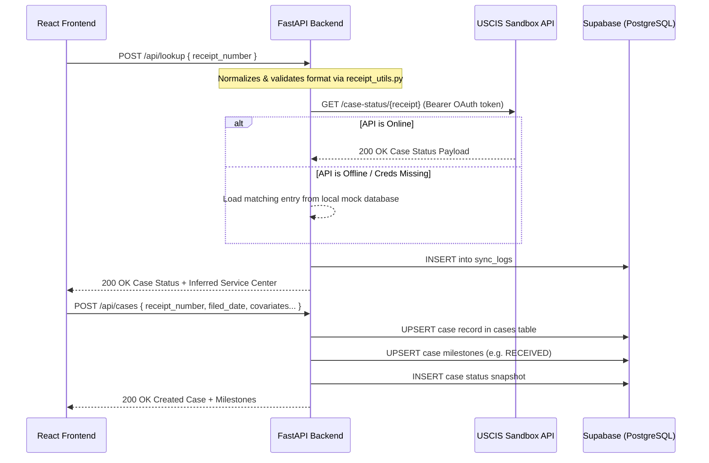
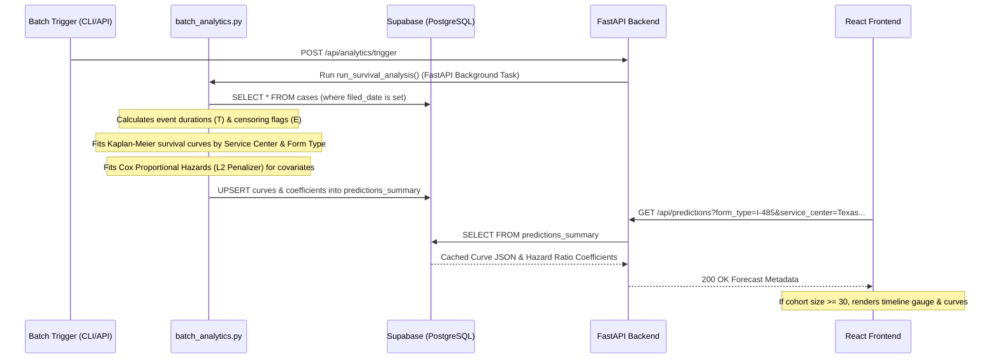

# Codebase Context & Architecture

This document serves as the official architectural source of truth for the **USCIS Case Status API-First Tracker** (formerly USCIS Immigration Timeline Predictor). It details the current state of the application, active data flows, core architectural rules, and the complete tech stack inventory.

---

## 1. Current State
The application is a production-grade full-stack system designed to track official USCIS case statuses using receipt numbers, map historical processing milestones, and generate gated wait-time forecasts.

### Key Capabilities:
1. **Receipt-First Tracking**: Users can look up case statuses using only their USCIS receipt number (e.g., `SRC9999132719`). Providing a filing date is optional and is not defaulted to the current date.
2. **Official USCIS Sandbox API Sync**: The backend integrates with the official USCIS Sandbox developer portal using an asynchronous OAuth 2.0 Client Credentials flow.
3. **Offline Resilience & Fallbacks**: If the USCIS Sandbox is offline (typically outside business hours) or if environment keys are missing, the client automatically catches connection errors or `503 Service Unavailable` statuses and falls back to a local mock database.
4. **Milestone History Extraction**:
   - **Sandbox API**: Extracts receipt dates and status modifications.
   - **Detailed JSON Import**: Parses raw JSON payloads exported from the internal `my.uscis.gov` account page, scanning case action logs, notices, and events to reconstruct a detailed milestone timeline (`RECEIVED`, `BIOMETRICS`, `RFE_SENT`, `RFE_RESPONSE`, `APPROVED`, `DENIED`).
5. **Gated wait-time forecasting**: Wait-time predictions (Kaplan-Meier survival percentiles and Cox hazard covariate adjustments) are computed and cached on the backend. In the UI, these forecasts are gated: they are hidden if the filing receipt date is missing or if the database cohort size for a specific service center and form type is less than 30 cases (a toggle allows bypassing this in Demo Mode).
6. **API Traffic & Integration Audit**: Tracks and audits Sandbox HTTP response codes, response latency, and error types. The UI displays consecutive days of healthy traffic to track readiness for production transition approval (which requires $\ge 5$ consecutive days of logged error-handling evidence).
7. **Traffic Simulator**: A utility script is included to generate randomized lookup traffic (including successes and deliberate client validation failures) and backdate them directly to the Supabase database to simulate multi-day logs.

---

## 2. Active Data Flow

### A. Receipt Lookup & Case Creation

### B. Statistical Survival Forecasting

### C. Detailed USCIS JSON Import
1. User copies the internal API JSON payload from `my.uscis.gov` and submits it in the **Import JSON** panel.
2. Frontend submits a `POST /api/cases/import-detailed` with the payload.
3. Backend parses nested keys (e.g., `events`, `notices`, `evidenceRequests`, `caseHistory`) using heuristics to extract the filing date, covariates, and event dates.
4. Backend upserts the case and reconstructed milestones to the database, returning the synchronized object to update the UI.

---

## 3. Core Architectural Rules

* **Database Schema Resilience**: The backend uses double-try blocks when writing to Supabase. If an upsert fails due to local database columns missing in a remote instance (e.g., custom metadata fields), it catches the exception and falls back to writing a simplified schema layout.
* **Separation of Concerns**:
  * **Backend**: FastAPI web layer, `uscis_client` API integration, `receipt_utils` pattern recognition, `batch_analytics` statistics engine.
  * **Frontend**: React client calling backend routers through `api/client.js` with receipt formats validated in `utils/receipt.js`.
* **Capped Cache Calculations**: Heavy mathematical modeling (via `lifelines`) is decoupled from runtime client request handlers. The data is pre-aggregated and saved in `predictions_summary` to maintain sub-100ms API response times.
* **Responsive Layout Grid**: Rendered utilizing a two-column `.dashboard-grid` layout (Left column: 420px for controls and lists; Right column: remaining width for details, gauges, and interactive charts) styled with modern CSS variables, glassmorphism shadows, and SVGs, avoiding bloated runtime graphic frameworks.

---

## 4. Tech Stack Inventory

### Backend (Python 3.x):
* **FastAPI** (`fastapi`): Modern, high-performance ASGI web framework for Python.
* **Uvicorn** (`uvicorn`): Production-grade ASGI web server.
* **Pandas** (`pandas`) & **NumPy** (`numpy`): Data analysis and reshaping structures.
* **Lifelines** (`lifelines`): Advanced survival analysis library (Kaplan-Meier survival models, Cox Proportional Hazards regression).
* **HTTPX** (`httpx`): Async HTTP client for OAuth and USCIS Sandbox API integrations.
* **Supabase Python Client** (`supabase`): PostgreSQL interaction layer.
* **Python-dotenv** (`python-dotenv`): Local environment configuration provider.

### Frontend (React / Javascript):
* **React** (`react` & `react-dom` v19.x): Core declarative user interface library.
* **Vite** (`vite`): Frontend build toolchain and rapid HMR development server.
* **Lucide React** (`lucide-react`): Premium vector icon asset pack.
* **HTML2Canvas** (`html2canvas`): Canvas screenshot utility for client-side timeline image sharing.
* **Vanilla CSS**: Curated dark theme styling with glowing neon variables, glassmorphism cards, and inline SVG charts.
